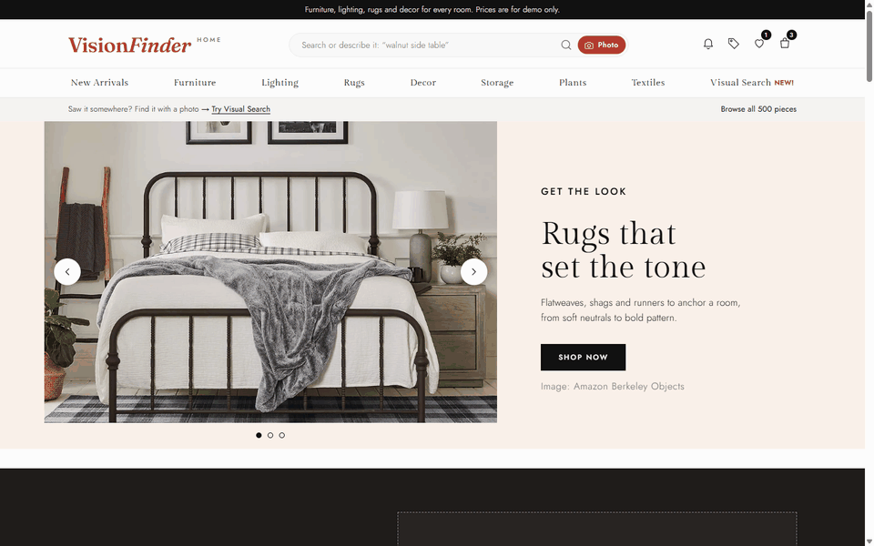
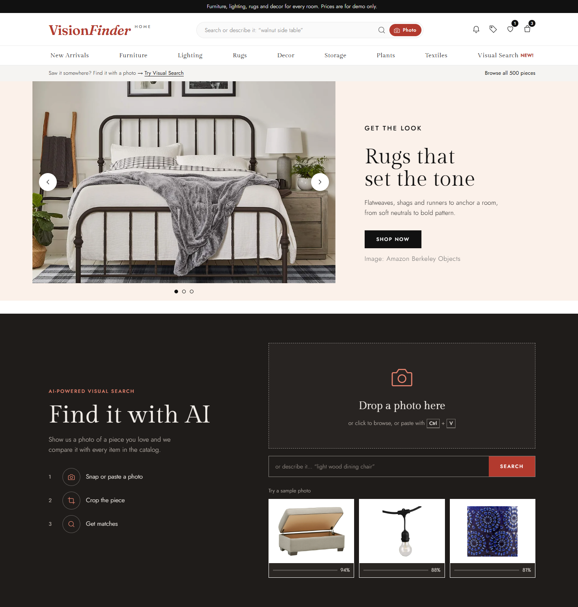
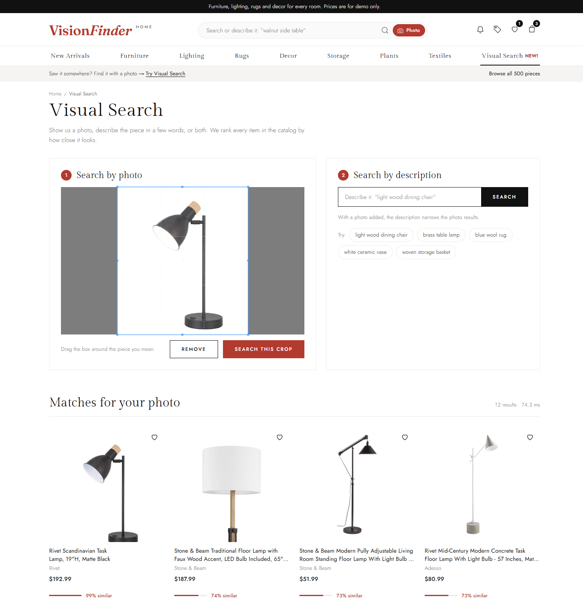
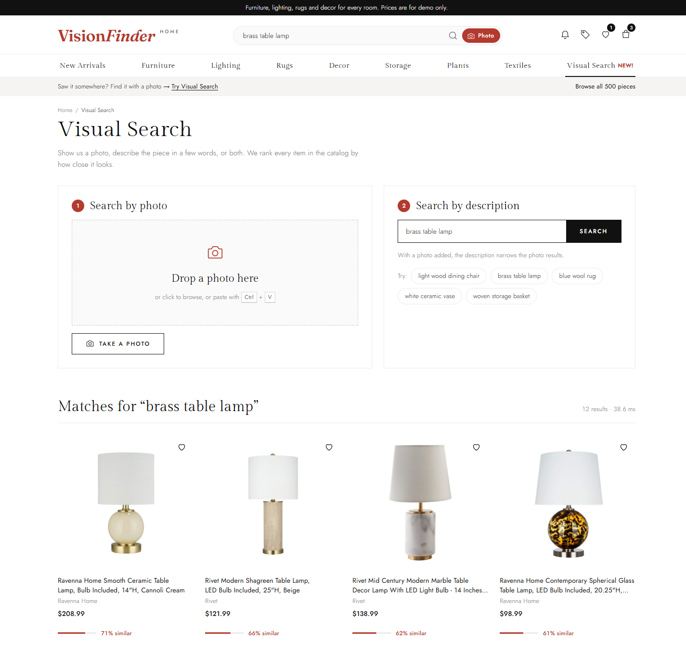
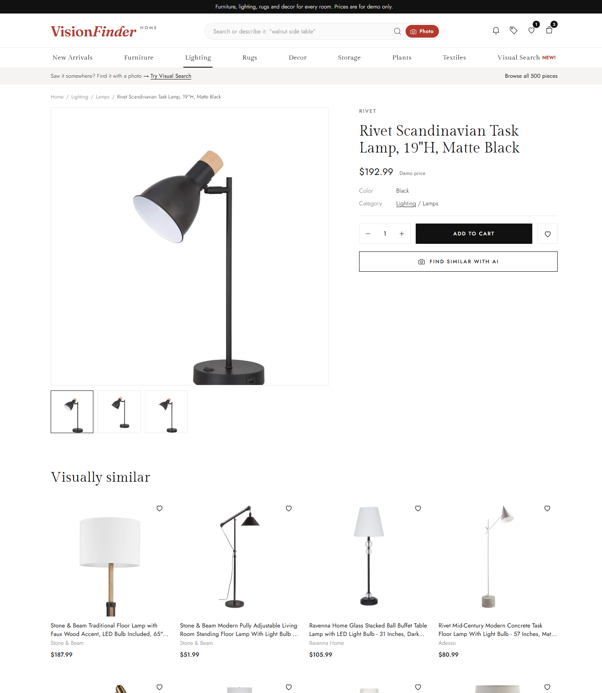
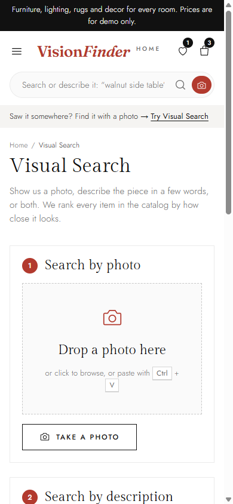

# VisionFinder Home

**Search home & living products by photo, not by keywords.**

VisionFinder Home is a home & living e-commerce demo with AI-powered visual search. Snap or upload a photo of a chair, lamp, rug or vase, crop the item you care about, and the system finds the closest matching products in the catalog. You can also search by a short text description.

> Work in progress. Items marked (planned) are not done yet. The frontend falls back to a simulated **demo mode** when the backend is offline.

## Features

- [x] **Image search**: upload / drag & drop / paste a photo, get the top-k most similar products with a similarity score
- [x] **Crop before search**: select only the product region of the photo
- [x] **Text search**: describe the product ("light wood dining chair") and search the same embedding space
- [x] **Confidence levels**: a photo search is labelled match, similar pieces, or "No confident match" instead of giving a wrong answer
- [x] **Visually similar**: product pages suggest look-alike items
- [ ] **Shop the look**: detect several items in a room photo and search each one (planned)
- [x] **Catalog**: 500 home & living products across 7 categories

## Screenshots

| Home | Search by photo |
|---|---|
|  |  |
| **Search by text** | **Product page** |
|  |  |

**Mobile**

## How it works

1. **Offline:** each product's main image is converted into a vector (embedding) by a pretrained CLIP model and stored in a FAISS index.
2. **Online:** the user's photo (or text) goes through the same model and is compared with all product vectors by cosine similarity.
3. The top-k closest products are returned with a confidence level from the best score: **high** (match), **medium** (similar pieces) or **low** ("No confident match").

**Why not train a classifier?** No large labeled dataset or GPU training is needed, and a new product becomes searchable by embedding its image, with no retraining. Trade-off: lower accuracy on near-identical products, controlled by the threshold.

## Dataset

Products come from the [Amazon Berkeley Objects (ABO)](https://amazon-berkeley-objects.s3.amazonaws.com/index.html) dataset.

| | |
|---|---|
| Catalog | 500 products, balanced across Furniture, Lighting, Rugs, Decor, Storage, Plants, Textiles |
| Holdout | 100 products not in the catalog, used to tune the "no match" threshold |
| Images | 1,766 images; each product has a main image plus other camera angles |

Evaluation uses the **other camera angles** of each product as queries, so accuracy is measured on real multi-view photos rather than synthetic augmentations.

`backend/prepare_data.py` selects the products (fixed seed) and downloads the images.

## Results

| Metric | Value |
|---|---|
| Top-1 accuracy | 60.0% |
| Top-5 accuracy | 74.7% |
| Latency per query (CPU, mean / p95) | 86 ms / 93 ms |
| Thresholds (default) | high >= 0.825, medium >= 0.70 |

Measured by `backend/evaluate.py` with OpenCLIP ViT-B-32 (`laion2b_s34b_b79k`): 999 positive queries (other camera angles of catalog products, not indexed) and 295 negative queries (every image of the 100 holdout products). Latency is one full query (decode, preprocess, embed, search) on CPU. Full numbers, including the threshold sweep, are in `backend/eval_results.json`.

| Category | Queries | Top-1 |
|---|---|---|
| Decor | 144 | 75.7% |
| Furniture | 143 | 58.7% |
| Lighting | 144 | 69.4% |
| Plants | 142 | 53.5% |
| Rugs | 142 | 44.4% |
| Storage | 142 | 72.5% |
| Textiles | 142 | 45.1% |

Thresholds are swept from 0.50 to 0.95 in 0.025 steps. **High** (0.825) has the largest gap between correct accepts and false accepts. **Medium** (0.70) is the lowest threshold where at least 60% of accepted queries are the right product. Override them with the `VF_THRESHOLD` and `VF_THRESHOLD_LOW` environment variables.

| Confidence | Catalog queries | Top-1 correct within level | Holdout queries |
|---|---|---|---|
| high (>= 0.825) | 30.7% | 88.3% | 18.3% |
| medium (0.70-0.825) | 33.6% | 66.7% | 34.9% |
| low (< 0.70) | 35.6% | 29.2% | 46.8% |

The levels do not separate cleanly: many holdout products are near-twins of catalog items (same brand and style), so even a high score does not guarantee the exact product.

## Experiments

Model comparison on the same queries (`backend/evaluate.py`, CPU, both at threshold 0.825):

| Model | Top-1 | Top-5 | Latency (mean / p95) | Correct accept / false accept @ 0.825 | Index build (500 images) |
|---|---|---|---|---|---|
| **ViT-B-32** (`laion2b_s34b_b79k`, default) | **60.0%** | 74.7% | **99 ms / 107 ms** | 27.1% / 18.3% | 30 s |
| ViT-B-16 (`laion2b_s34b_b88k`) | 59.6% | **75.2%** | 158 ms / 170 ms | 30.7% / 18.3% | 77 s |

ViT-B-16 is not clearly better (Top-1 -0.4 points, Top-5 +0.5 points) and is about 1.6x slower, so ViT-B-32 stays the default. To try another model, set `VF_MODEL` and `VF_PRETRAINED` before `build_index.py`, `evaluate.py` and `uvicorn`; each model gets its own index file in `backend/data/`.

## Tech stack

| Layer | Tech |
|---|---|
| Frontend | HTML, CSS, vanilla JavaScript, Cropper.js |
| Backend API | Python, FastAPI |
| Image preprocessing | Pillow |
| Multimodal model | CLIP (OpenCLIP ViT-B-32) |
| Vector search | FAISS (cosine similarity) |

## Project structure

    VisionFinder/
    ├── frontend/
    │   ├── index.html, products.html, product.html, cart.html, search.html
    │   ├── data/products.json      # catalog (shared with backend)
    │   └── assets/products/        # product images (shared with backend)
    └── backend/
        ├── prepare_data.py         # select products from ABO + download images
        ├── config.py               # shared paths, model name, threshold, CORS
        ├── embedder.py             # image preprocessing + CLIP embeddings
        ├── build_index.py          # images -> CLIP vectors -> FAISS index (backend/data/)
        ├── search_engine.py        # image / text / similar search (used by app + evaluate)
        ├── app.py                  # FastAPI search API
        ├── evaluate.py             # Top-1 / Top-5 / latency / threshold sweep
        └── tests/test_api.py       # API tests (pytest)

## Getting started

**Frontend:** open the repo in VS Code and run Live Server (root is `frontend/`, port 5501).

**Data (already included):** to rebuild, download `abo-listings.tar` and `images.csv.gz` from ABO, then run `python backend/prepare_data.py`.

**Backend** (PowerShell, tested on Python 3.14; the first run downloads the CLIP model, about 600 MB):

    cd backend
    python -m venv .venv
    .venv\Scripts\Activate.ps1
    pip install -r requirements.txt
    python build_index.py          # ~30 s on CPU; add --limit 20 for a quick test
    python -m pytest -q            # optional
    python evaluate.py             # optional, rewrites eval_results.json
    uvicorn app:app --port 8000

With the API running on port 8000, reload the frontend: the "Demo mode" badge disappears and searches hit the real model. Endpoints: `GET /api/health`, `POST /api/search/image`, `GET /api/search/text?q=`, `GET /api/similar/{id}` (docs at http://127.0.0.1:8000/docs).

## Roadmap

- [x] Select 500 home & living products from ABO
- [x] Frontend redesign (Scandinavian minimal) with AI search UI
- [x] CLIP embeddings + FAISS index
- [x] Search API + frontend integration
- [x] Evaluation and threshold tuning
- [ ] Deploy (GitHub Pages + Hugging Face Spaces)
- [ ] Shop the look

## Credits

Product data and images: Amazon.com, [Amazon Berkeley Objects](https://amazon-berkeley-objects.s3.amazonaws.com/index.html), licensed under [CC BY 4.0](https://creativecommons.org/licenses/by/4.0/). Images are unmodified. Prices shown on the site are for demo only.

Built at Hanoi University, Faculty of Information Technology.
