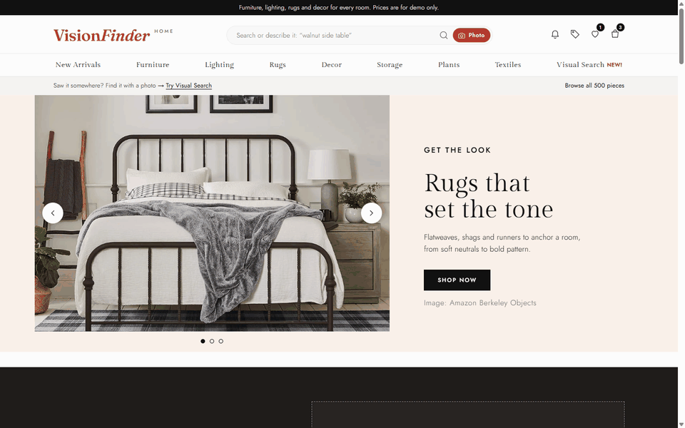

# VisionFinder Home

**Search home & living products by photo, not by keywords.**

VisionFinder Home is a home & living e-commerce demo with AI-powered visual search. Snap or upload a photo of a chair, lamp, rug or vase, crop the item you care about, and the system finds the closest matching products in the catalog. You can also search by a short text description, or ask **Aurora**, the shopping assistant, what you are looking for.

Course project for ATI (topic 21: *Multimodal Product Recognition System*), Faculty of Information Technology, Hanoi University.

> When the backend is offline, the frontend falls back to a simulated **demo mode** (a "Demo mode" badge is shown).

| Folder | What it is | How to run it |
|---|---|---|
| `frontend/` | Static web app: HTML, CSS, vanilla JavaScript (ES modules), Cropper.js | `python -m http.server 5501 --directory frontend` (or VS Code Live Server) |
| `backend/` | FastAPI search API: OpenCLIP (ViT-B-32) + FAISS + Pillow | `pip install -r requirements.txt && python build_index.py && uvicorn app:app --port 8000` |
| `docs/` | Course report, code documentation (Vietnamese), figures | — |

## Features

- [x] **Image search**: upload / drag & drop / paste a photo, get the top-k most similar products with a similarity score
- [x] **Crop before search**: select only the product region of the photo
- [x] **Text search**: describe the product ("light wood dining chair") and search the same embedding space
- [x] **Confidence levels**: a photo search is labelled match, similar pieces, or "No confident match" instead of giving a wrong answer
- [x] **Visually similar**: product pages suggest look-alike items
- [x] **Shopping assistant (Aurora)**: a chat button on every page; type what you want to buy or send a photo, and matching products appear right in the chat
- [x] **Accounts**: register / log in (MySQL), cart and wishlist saved to the account, search history page
- [x] **Add products without retraining**: `POST /api/products` embeds one image and makes the product searchable at once
- [x] **Catalog**: 500 home & living products across 7 categories

## How it works

1. **Offline:** each product's main image is converted into a vector (embedding) by a pretrained CLIP model and stored in a FAISS index.
2. **Online:** the user's photo (or text) goes through the same model and is compared with all product vectors by cosine similarity.
3. The top-k closest products are returned with a confidence level from the best score: **high** (match), **medium** (similar pieces) or **low** ("No confident match").

4. **New products** (`POST /api/products`) are embedded and added to the in-memory index at once; no rebuild.

**Why not train a classifier?** No large labeled dataset or GPU training is needed, and a new product becomes searchable by embedding its image, with no retraining. Trade-off: lower accuracy on near-identical products, controlled by the threshold.

## Shopping assistant (Aurora)

Aurora is a rule-based assistant in `frontend/js/chatbot.js`. It does not use an LLM or any outside API: it only understands shopping requests and sends them to the same CLIP search as the search page.

- **Open the chat:** a blue launcher in the bottom-right corner of every page. A greeting bubble appears once per session. The launcher can be dragged; it snaps to the left or right edge and remembers its position.
- **Ask:** type what you want ("I want a pillow", "light wood chair") or tap a suggestion chip (Pillows, Lamps, Rugs, Chairs, Plants, Mirrors). If the request is short, Aurora asks for a color and a budget first.
- **Results in the chat:** each card shows the image, name and price, with **Add to cart** and a link to the product page.
- **Follow-ups:** "show more", "cheaper", "under $100", "blue ones" refine the last results without a new search.
- **Photo search:** the camera button sends a photo to the image search.
- **Language:** Aurora always answers in English; basic Vietnamese input is translated with a small keyword table (gối → pillow, đèn → lamp, rẻ hơn → cheaper).
- **Logged-in users** are greeted by name. **New chat** clears the conversation. The chat history is kept for the browser session only.

## Dataset

Products come from the [Amazon Berkeley Objects (ABO)](https://amazon-berkeley-objects.s3.amazonaws.com/index.html) dataset.

| | |
|---|---|
| Catalog | 500 products, balanced across Furniture, Lighting, Rugs, Decor, Storage, Plants, Textiles |
| Holdout | 100 products not in the catalog, used to tune the "no match" threshold |
| Images | 1,766 images; each product has a main image plus other camera angles |

Evaluation uses the **other camera angles** of each product as queries, so accuracy is measured on real multi-view photos rather than synthetic augmentations.

`backend/prepare_data.py` selects the products (fixed seed) and downloads the images.

## Results

| Metric | Value |
|---|---|
| Top-1 accuracy | 60.0% |
| Top-5 accuracy | 74.7% |
| Latency per query (CPU, mean / p95) | 86 ms / 93 ms |
| Thresholds (default) | high >= 0.825, medium >= 0.70 |

Measured by `backend/evaluate.py` with OpenCLIP ViT-B-32 (`laion2b_s34b_b79k`): 999 positive queries (other camera angles of catalog products, not indexed) and 295 negative queries (every image of the 100 holdout products). Latency is one full query (decode, preprocess, embed, search) on CPU. Full numbers, including the threshold sweep, are in `backend/eval_results.json`.

| Category | Queries | Top-1 |
|---|---|---|
| Decor | 144 | 75.7% |
| Furniture | 143 | 58.7% |
| Lighting | 144 | 69.4% |
| Plants | 142 | 53.5% |
| Rugs | 142 | 44.4% |
| Storage | 142 | 72.5% |
| Textiles | 142 | 45.1% |

Thresholds are swept from 0.50 to 0.95 in 0.025 steps. **High** (0.825) has the largest gap between correct accepts and false accepts. **Medium** (0.70) is the lowest threshold where at least 60% of accepted queries are the right product. Override them with the `VF_THRESHOLD` and `VF_THRESHOLD_LOW` environment variables.

| Confidence | Catalog queries | Top-1 correct within level | Holdout queries |
|---|---|---|---|
| high (>= 0.825) | 30.7% | 88.3% | 18.3% |
| medium (0.70-0.825) | 33.6% | 66.7% | 34.9% |
| low (< 0.70) | 35.6% | 29.2% | 46.8% |

The levels do not separate cleanly: many holdout products are near-twins of catalog items (same brand and style), so even a high score does not guarantee the exact product.

## Experiments

Model comparison on the same queries (`backend/evaluate.py`, CPU, both at threshold 0.825):

| Model | Top-1 | Top-5 | Latency (mean / p95) | Correct accept / false accept @ 0.825 | Index build (500 images) |
|---|---|---|---|---|---|
| **ViT-B-32** (`laion2b_s34b_b79k`, default) | **60.0%** | 74.7% | **99 ms / 107 ms** | 27.1% / 18.3% | 30 s |
| ViT-B-16 (`laion2b_s34b_b88k`) | 59.6% | **75.2%** | 158 ms / 170 ms | 30.7% / 18.3% | 77 s |

ViT-B-16 is not clearly better (Top-1 -0.4 points, Top-5 +0.5 points) and is about 1.6x slower, so ViT-B-32 stays the default. To try another model, set `VF_MODEL` and `VF_PRETRAINED` before `build_index.py`, `evaluate.py` and `uvicorn`; each model gets its own index file in `backend/data/`.

**Multi-view index** (`python build_index.py --views 2`): index the main image plus the first extra angle. A product's score is its best image's score, and each product appears once in the results. Fair test with `backend/compare_views.py`: both indexes are queried with each product's second extra angle, which neither indexes (499 queries).

| Index | Top-1 | Top-5 |
|---|---|---|
| **Main image only** (default) | **57.3%** | **71.7%** |
| Main + angle 1 | 42.9% | 63.9% |

Multi-view is 14.4 points worse, so it stays off. In ABO the extra angles are often room scenes (a sofa in a styled living room), and a query photo of one room scene matches another product's room scene. 93% of the wrong top-1 hits came from an angle-1 image. Indexing more angles should only help with clean, product-only angle photos.

## Tech stack

| Layer | Tech | Used for |
|---|---|---|
| Frontend | HTML, CSS, vanilla JavaScript (ES modules), no framework | Shop pages (home, catalog, product, cart, search, login, search history); cart and saved items in `localStorage`, synced to the account when logged in |
| Frontend | Cropper.js 1.6.2 (CDN) | Cropping the product region before search |
| Frontend | Vanilla JavaScript (`chatbot.js`), inline SVG mascot | Aurora shopping assistant: rule-based intent parsing, calls the text / image search API |
| Backend | Python, FastAPI, Uvicorn, python-multipart | Search API (`/api/search/image`, `/api/search/text`, `/api/similar/{id}`, `/api/health`), image upload, adding products (`POST /api/products`) |
| Accounts | MySQL (XAMPP), SQLAlchemy, PyMySQL, bcrypt, PyJWT, python-dotenv | Users, server-side cart and wishlist, search history (`/api/auth/*`, `/api/me/*`) |
| AI & search | PyTorch (CPU), OpenCLIP ViT-B-32 (`laion2b_s34b_b79k`) | Image and text embeddings in one shared space |
| AI & search | FAISS (`faiss-cpu`), NumPy | Vector index and cosine-similarity top-k search |
| Data | Amazon Berkeley Objects, Pillow | Catalog source (`prepare_data.py`); image loading, resizing and thumbnails (`make_thumbs.py`) |
| Testing | pytest, httpx | API tests (`tests/test_api.py`, `tests/test_products.py`), account tests on SQLite (`tests/test_auth.py`); `evaluate.py` for Top-1 / Top-5 / latency |

## Project structure

    VisionFinder/
    ├── frontend/
    │   ├── index.html, products.html, product.html, cart.html, search.html
    │   ├── login.html, history.html # account pages (js/account.js talks to /api/auth, /api/me)
    │   ├── js/chatbot.js, css/chatbot.css # Aurora shopping assistant (loaded on every page by js/layout.js)
    │   ├── data/products.json      # catalog (shared with backend)
    │   └── assets/products/        # product images (shared with backend)
    ├── docs/                       # report (PDF, Word), code documentation (Vietnamese), figures, screenshots
    └── backend/
        ├── prepare_data.py         # select products from ABO + download images
        ├── config.py               # shared paths, model name, threshold, CORS
        ├── embedder.py             # image preprocessing + CLIP embeddings
        ├── build_index.py          # images -> CLIP vectors -> FAISS index (backend/data/)
        ├── search_engine.py        # image / text / similar search (used by app + evaluate)
        ├── app.py                  # FastAPI search API
        ├── db.py                   # MySQL tables (SQLAlchemy); `python db.py` creates them
        ├── auth.py                 # register / login (JWT), cart, wishlist, search history API
        ├── .env.example            # copy to .env: DATABASE_URL, JWT_SECRET
        ├── evaluate.py             # Top-1 / Top-5 / latency / threshold sweep
        ├── compare_views.py        # main-only vs multi-view index on the same queries
        └── tests/                  # test_api.py (search), test_products.py (add product), test_auth.py (accounts, SQLite)

## How to run locally

**Requirements:** Python 3.12+, Git, about 2 GB free disk space (libraries, plus the CLIP model, about 600 MB, downloaded on the first run).

**1. Clone the repo**

    git clone https://github.com/anomaly1205/VisionFinder.git
    cd VisionFinder

**2. Start the backend** (terminal 1)

Windows (PowerShell):

    cd backend
    python -m venv .venv
    .venv\Scripts\Activate.ps1
    pip install -r requirements.txt
    python build_index.py          # ~30 s on CPU; add --limit 20 for a quick test
    uvicorn app:app --port 8000

macOS / Linux:

    cd backend
    python3 -m venv .venv
    source .venv/bin/activate
    pip install -r requirements.txt
    python build_index.py          # ~30 s on CPU; add --limit 20 for a quick test
    uvicorn app:app --port 8000

**3. Start the frontend** (terminal 2, from the repo root)

    python -m http.server 5501 --directory frontend

Open http://127.0.0.1:5501. Keep port 5501 (or 5500): the backend only accepts requests from these origins (CORS, see `backend/config.py`).

**4. Check it works**

- http://127.0.0.1:8000/docs opens the API docs.
- The website no longer shows the "Demo mode" badge, and searches hit the real model.

**Optional** (in `backend/`, with the virtual environment active):

    python -m pytest -q            # API tests
    python evaluate.py             # rewrites eval_results.json

**Add a product** (admin only). Start the backend with a key, then post an image:

    $env:ADMIN_KEY = "choose-a-long-secret"; uvicorn app:app --port 8000
    curl.exe -X POST http://127.0.0.1:8000/api/products -H "X-Admin-Key: choose-a-long-secret" `
      -F "file=@lamp.jpg" -F "name=Brass desk lamp" -F "category=Lighting" -F "price=49.90"

The product is searchable at once (about 70 ms on CPU). The record goes to `backend/data/added_products.json` and the image to `backend/data/added/`; both are re-embedded at startup. Without `ADMIN_KEY` the endpoint answers 503; a wrong key gives 401. Added products are found by search, but the shop pages only show products from `frontend/data/products.json`.

### Accounts and MySQL (optional)

Search works without a database. Accounts (log in, cart and wishlist on the server, search history) need MySQL.

1. Install [XAMPP](https://www.apachefriends.org/), open the XAMPP Control Panel and click **Start** next to **MySQL**. The default user is `root` with no password, on port 3306.
2. Create the settings file (in `backend/`, PowerShell):

       Copy-Item .env.example .env
       python -c "import secrets; print(secrets.token_urlsafe(32))"

   Paste the printed value after `JWT_SECRET=` in `backend/.env`. Change `DATABASE_URL` only if your MySQL user, password or port differ. `backend/.env` is gitignored.
3. Create the database `visionfinder` and its tables (safe to run again):

       python db.py

4. Restart `uvicorn app:app --port 8000`. Open http://127.0.0.1:5501/login.html and create an account.

If MySQL is stopped, the account endpoints answer `503 Database unavailable`, and search keeps working. `tests/test_auth.py` uses a temporary SQLite file, so `pytest` does not need MySQL.

**Data (already included):** to rebuild, download `abo-listings.tar` and `images.csv.gz` from ABO, then run `python backend/prepare_data.py`.

### Troubleshooting

- **"Demo mode" badge still shows:** the backend is not running, or not on port 8000. Start `uvicorn app:app --port 8000`, then hard-reload the page (Ctrl+F5).
- **`Activate.ps1` is blocked** ("running scripts is disabled"): run `Set-ExecutionPolicy -Scope CurrentUser RemoteSigned` once, then activate again.
- **`python db.py` says "Cannot reach the database":** MySQL is not started in XAMPP, or `DATABASE_URL` in `backend/.env` is wrong.
- **`pip` fails on `torch`:** check your Python version with `python --version`. Use Python 3.12 or newer, 64-bit.

## Credits

Product data and images: Amazon.com, [Amazon Berkeley Objects](https://amazon-berkeley-objects.s3.amazonaws.com/index.html), licensed under [CC BY 4.0](https://creativecommons.org/licenses/by/4.0/). Images are unmodified. Prices shown on the site are for demo only.

Built at Hanoi University, Faculty of Information Technology.
