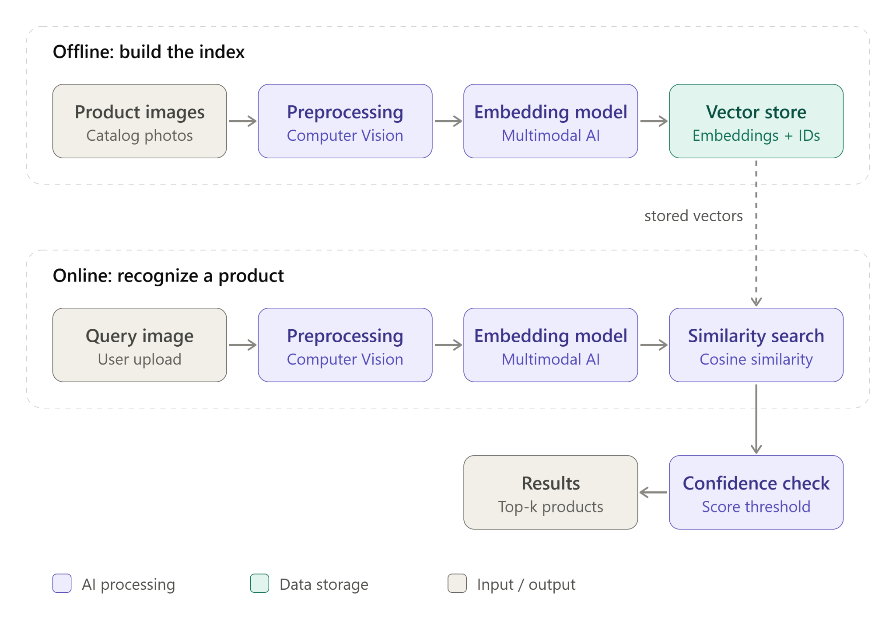
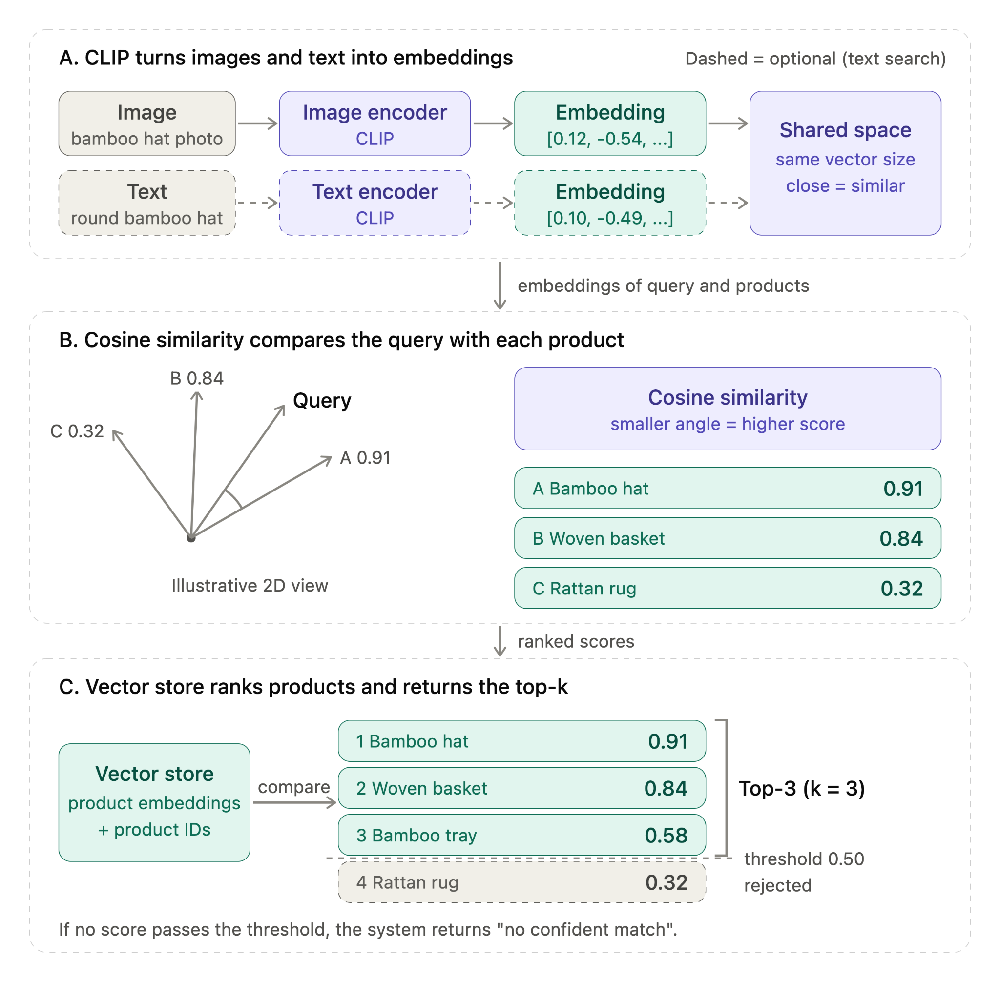

# Documentation

Course documents for **VisionFinder**: ATI assignment, Faculty of Information Technology, Hanoi University.

| File | Description |
|---|---|
| [ATI_Report.pdf](ATI_Report.pdf) | Project report (read online) |
| [ATI_Report.docx](ATI_Report.docx) | Project report (editable Word file) |
| [images/architecture.png](images/architecture.png) | Figure 1: system architecture (offline + online pipelines) |
| [images/clip-similarity.png](images/clip-similarity.png) | Figure 2: CLIP embeddings, cosine similarity, vector store and top-k |

## System architecture

**Offline:** catalog images are preprocessed, converted into embeddings by a multimodal model (CLIP) and stored in a vector store with their product IDs.
**Online:** the user's query image goes through the same steps, is compared with the stored vectors by cosine similarity, and the top-k products are returned if the best score passes a confidence threshold; otherwise the system answers "no confident match".

## Changes since the report

The report describes the original plan. The implementation has since changed in these ways:

| Report | Current project |
|---|---|
| Handicraft product examples (bamboo hat, rattan rug) | Home & living catalog: Furniture, Lighting, Rugs, Decor, Storage, Plants, Textiles |
| Dataset collected by the team | 500 products from the Amazon Berkeley Objects (ABO) dataset, plus 100 holdout products for threshold tuning |
| Image search only (text search as a possible extension) | Image search with crop, plus text search in the same CLIP embedding space |
| Targets X, Y, Z, N to be decided | To be measured with real multi-view queries (other camera angles of each product) |

## Team

Tran Duc Tri, Ha Thai Son, Dau Tien Duc, Nguyen Dinh Huy
